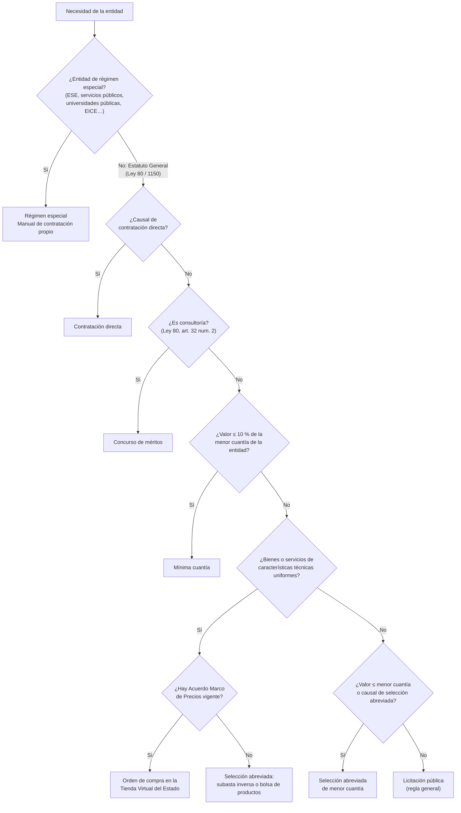
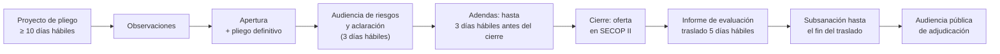
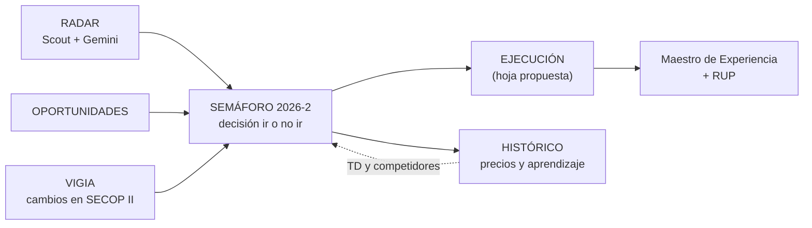

# Flujo de la contratación estatal en SECOP II · activo estratégico de CKOP
Versión 05-nov-2026 · Borrador para revisión de MMP · Fuente única del módulo de etapas de CKOP

**Tesis.** B&A ya gestiona bien la etapa **precontractual**: el Maestro de Licitaciones registra observaciones, manifestación de interés, cierre, evaluación y subsanación. El valor que se pierde está **después de la adjudicación**. Según el Maestro de Experiencia, solo 9 de 64 contratos del RUP tienen soporte verificado, y la mayoría de las carpetas conserva solo la certificación de la entidad. Un contrato que no se liquida, no se certifica y no se archiva **no acredita experiencia en el siguiente proceso**. Por eso CKOP debe cubrir las tres etapas, no solo el radar.

Cómo leerlo: cada etapa tiene dos carriles, **Entidad** (lo que hace la entidad estatal) y **B&A** (lo que hace la firma como proponente o contratista). Los plazos citan su norma. Lo marcado **[VERIFICAR]** se confirma contra la fuente oficial antes de publicarlo o enseñarlo en EVA.

Marco normativo base: Ley 80 de 1993 · Ley 1150 de 2007 · Ley 1474 de 2011 · Decreto-Ley 019 de 2012 · Decreto 1082 de 2015 (compila el reglamento) · Ley 1882 de 2018 · Ley 2069 de 2020 · Ley 2195 de 2022 · manuales y guías de Colombia Compra Eficiente (CCE).

---

## 1. Mapa general (las tres etapas)

```mermaid
flowchart LR
  subgraph PRE["1 · Precontractual"]
    direction TB
    P1["PAA publicado<br/>(31 de enero)"] --> P2["Estudios previos,<br/>análisis del sector, riesgos, CDP"]
    P2 --> P3["Aviso de convocatoria<br/>+ proyecto de pliego"]
    P3 --> P4["Observaciones<br/>y respuestas"]
    P4 --> P5["Apertura +<br/>pliego definitivo"]
    P5 --> P6["Ofertas en SECOP II<br/>(cierre)"]
    P6 --> P7["Evaluación, traslado<br/>y subsanación"]
    P7 --> P8{"¿Adjudica?"}
  end
  subgraph CON["2 · Contractual"]
    direction TB
    C1["Firma en SECOP II"] --> C2["Garantías aprobadas<br/>+ RP + seguridad social"]
    C2 --> C3["Acta de inicio"]
    C3 --> C4["Ejecución, informes,<br/>supervisión y pagos"]
    C4 --> C5["Modificaciones:<br/>adición, prórroga, suspensión"]
  end
  subgraph POS["3 · Poscontractual"]
    direction TB
    Q1["Terminación"] --> Q2["Liquidación<br/>(bilateral o unilateral)"]
    Q2 --> Q3["Cierre del expediente"]
    Q3 --> Q4["Certificación de experiencia<br/>→ Maestro de Experiencia → RUP"]
  end
  P8 -- "Sí" --> C1
  P8 -- "Desierta" --> P2
  C5 --> Q1
  Q4 -. "acredita la experiencia<br/>del siguiente proceso" .-> P6
```

## 2. ¿Qué modalidad aplica? (árbol de decisión)

**Menor cuantía** (Ley 1150 de 2007, art. 2, num. 2, lit. b), según el presupuesto anual de la entidad en SMMLV:

| Presupuesto anual de la entidad | Menor cuantía | Mínima cuantía (10 %) |
|---|---|---|
| ≥ 1.200.000 SMMLV | hasta 1.000 SMMLV | hasta 100 SMMLV |
| 850.000 a < 1.200.000 | hasta 850 SMMLV | hasta 85 SMMLV |
| 400.000 a < 850.000 | hasta 650 SMMLV | hasta 65 SMMLV |
| 120.000 a < 400.000 | hasta 450 SMMLV | hasta 45 SMMLV |
| < 120.000 | hasta 280 SMMLV | hasta 28 SMMLV |

## 3. Las modalidades frente a frente

| | Licitación pública | Selección abreviada de menor cuantía | Subasta inversa (SA) | Concurso de méritos | Mínima cuantía | Contratación directa | Régimen especial |
|---|---|---|---|---|---|---|---|
| **Cuándo** | Regla general | Valor ≤ menor cuantía y otras causales del art. 2 Ley 1150 | Bienes y servicios de características técnicas uniformes | Consultoría | ≤ 10 % de la menor cuantía | Causales taxativas (Ley 1150, art. 2, num. 4) | Entidades exceptuadas |
| **Proyecto de pliego** | ≥ 10 días hábiles antes de la apertura | ≥ 5 días hábiles | ≥ 5 días hábiles | ≥ 10 días hábiles | No hay: invitación pública | No aplica | Según manual |
| **Paso previo del proponente** | — | **Manifestación de interés** en los 3 días hábiles siguientes a la apertura | — | Precalificación opcional (lista corta) | — | Invitación de la entidad | Según manual |
| **Criterio de selección** | Calidad + precio (mayor puntaje) | Calidad + precio | **Menor precio** en la subasta | Calidad: experiencia, equipo, formación. **El precio no puntúa** | **Menor precio** que cumpla | Idoneidad y experiencia | Según manual |
| **Traslado del informe de evaluación** | 5 días hábiles | 3 días hábiles | Informe de habilitación [VERIFICAR plazo] | 3 días hábiles | 1 día hábil | No aplica | Según manual |
| **Adjudicación** | Audiencia pública | Acto administrativo motivado | Al menor lance | Acto motivado, tras revisar la oferta económica del primero | **Comunicación de aceptación** (oferta + aceptación = contrato) | Firma del contrato | Según manual |
| **Garantía de seriedad** | Sí (≥ 10 % de la oferta) | Sí | Sí | Sí | **Opcional** | Opcional, justificada | Según manual |
| **RUP** | Sí | Sí | Sí | Sí | **No** se exige (Ley 1150, art. 6) | **No** se exige | Según manual |
| **Norma** | Ley 80, art. 30 · D. 1082, 2.2.1.2.1.1.1 y ss. | D. 1082, 2.2.1.2.1.2.20 | D. 1082, 2.2.1.2.1.2.2 y ss. | D. 1082, 2.2.1.2.1.3.1 y ss. | Ley 1474, art. 94 · D. 1082, 2.2.1.2.1.5.1 y ss. | D. 1082, 2.2.1.2.1.4.1 y ss. | Ley 1150, art. 13 · Ley 2195 de 2022 [VERIFICAR artículo] |
| **Presencia en el Maestro** | Licitación | 31 en HISTÓRICO | — | Concurso de méritos abierto | 25 en HISTÓRICO | CSC (1C) | 3 en HISTÓRICO |

## 4. Etapa precontractual

### 4.1 Común a todas las modalidades: planeación

| Paso | Entidad | B&A | Norma |
|---|---|---|---|
| Plan Anual de Adquisiciones | Lo publica en SECOP II a más tardar el 31 de enero y lo actualiza al menos una vez al año | **Leer el PAA de las entidades objetivo en enero**: es la señal de demanda más temprana (el pipeline UNIR se programa entre enero y abril) | D. 1082, 2.2.1.1.1.4.1 y 2.2.1.1.1.4.3 |
| Estudios y documentos previos | Necesidad, objeto, modalidad, valor estimado, criterios, riesgos, garantías | Anticipar requisitos habilitantes y UNSPSC; preparar experiencia y equipo | D. 1082, 2.2.1.1.2.1.1 |
| Análisis del sector | Estudio de mercado y de oferta | **Insumo para el precio**: medianas de contratos similares en SECOP II | D. 1082, 2.2.1.1.1.6.1 |
| Requisitos habilitantes | Capacidad jurídica, financiera, organizacional y experiencia, verificadas en el RUP | Comparar con el RUP de B&A: liquidez 267,4, endeudamiento 0,32 %. Con pasivo casi nulo, preparar el oficio explicativo para indicadores indeterminados | D. 1082, 2.2.1.1.1.6.2 |
| Matriz de riesgos | Tipificación, estimación y asignación | Revisar riesgos asignados al contratista antes de decidir | D. 1082, 2.2.1.1.1.6.3 |
| CDP | Certificado de disponibilidad presupuestal | — | Estatuto Orgánico de Presupuesto |
| Aviso de convocatoria | Publicado en SECOP II con objeto, modalidad, plazos y presupuesto | **Radar CKOP**: detectarlo el mismo día | D. 1082, 2.2.1.1.2.1.2 |
| Convocatoria limitada a mipymes | Si se cumplen las condiciones y las mipymes la solicitan | B&A es microempresa: **solicitar la limitación** cuando aplique | D. 1082, 2.2.1.2.4.2.2, modificado por D. 1860 de 2021 [VERIFICAR condiciones] |
| Publicidad | Todo documento del proceso en SECOP II dentro de los 3 días siguientes a su expedición | Vigía CKOP: alertar cambios | D. 1082, 2.2.1.1.1.7.1 |

### 4.2 Licitación pública

| Hito | Plazo | Qué hace B&A | Columna del Maestro | Error típico |
|---|---|---|---|---|
| Proyecto de pliego | ≥ 10 días hábiles antes de la apertura | Observar requisitos desproporcionados (experiencia, indicadores, UNSPSC) | Fecha Observaciones Proyecto Pliego | No observar a tiempo y quedar fuera por un requisito que se pudo ajustar |
| Audiencia de riesgos y aclaración | Dentro de los 3 días hábiles siguientes al inicio del plazo para ofertar (Ley 80, art. 30, num. 4) | Asistir y dejar constancia de las dudas | — | — |
| Adendas | Hasta 3 días hábiles antes del cierre (Ley 1882 de 2018) | Revisar cada adenda | Vigía | Ofertar con un pliego desactualizado |
| Cierre | Fecha del pliego | Oferta completa en SECOP II; garantía de seriedad ≥ 10 % de la oferta (D. 1082, 2.2.1.2.3.1.9). Oferta económica en sobre separado (Ley 1882 de 2018) [VERIFICAR alcance] | 🔔 Fecha Presentar Propuesta | Cargar archivos al límite de la hora de cierre |
| Informe de evaluación | Traslado de 5 días hábiles (Ley 80, art. 30, num. 8) | Observar el informe y revisar a los competidores | Fecha Informe Evaluación | No revisar las ofertas de los demás |
| Subsanación | Hasta el término de traslado del informe (Ley 1150, art. 5, par. 1, modificado por Ley 1882 de 2018) | Subsanar solo lo que no asigna puntaje | Fecha Subsanación | Intentar mejorar la oferta: no se puede |
| Adjudicación | Audiencia pública; el acto es irrevocable (Ley 1150, art. 9) | Asistir; si se pierde, registrar el aprendizaje | Estado SECOP · Aprendizaje | Perder el dato del ganador y su precio |

### 4.3 Selección abreviada de menor cuantía (D. 1082, art. 2.2.1.2.1.2.20)

| Hito | Plazo | Qué hace B&A | Columna del Maestro |
|---|---|---|---|
| Proyecto de pliego | ≥ 5 días hábiles antes de la apertura | Observar | Fecha Observaciones Proyecto Pliego |
| Apertura y pliego definitivo | — | Decisión de ir o no ir | Semáforo |
| **Manifestación de interés** | Dentro de los 3 días hábiles siguientes a la apertura. **Sin ella no se puede ofertar** | Manifestar el primer día | 🚨 Fecha Manifestar Interés · 🚨 Días para Manifestar Interés |
| Sorteo | Opcional, si hay más de 10 manifestaciones | Seguir el resultado | Vigía |
| Cierre | Fecha del pliego | Oferta + garantía de seriedad | 🔔 Fecha Presentar Propuesta |
| Informe de evaluación | Traslado de 3 días hábiles | Observar | Fecha Informe Evaluación |
| Subsanación | Hasta el fin del traslado | Subsanar | Fecha Subsanación |
| Adjudicación | Acto administrativo motivado | — | Estado SECOP |

En el Maestro hay casos de «No se manifestó interés por falta de organización»: **perder la manifestación de interés es perder el proceso**. CKOP alerta con D-3, D-2 y D-1.

### 4.4 Selección abreviada por subasta inversa y Acuerdos Marco (características técnicas uniformes)
- **Subasta inversa** (D. 1082, 2.2.1.2.1.2.2 y ss.): ficha técnica, oferta con documentos habilitantes y precio inicial, informe de habilitación y subasta electrónica con margen mínimo de mejora. Gana el menor precio. Si solo hay un oferente habilitado, la entidad puede adjudicarle si su oferta no excede el presupuesto [VERIFICAR].
- **Acuerdos Marco de Precios** (D. 1082, 2.2.1.2.1.2.7 y ss.): CCE adjudica el acuerdo y las entidades compran en la **Tienda Virtual del Estado Colombiano** mediante órdenes de compra y eventos de cotización. Es obligatorio para la rama ejecutiva del orden nacional y su alcance territorial depende de normas posteriores [VERIFICAR]. Para B&A, la vía es **ser proveedor del acuerdo** cuando CCE lo licite, no la entidad.

### 4.5 Concurso de méritos (D. 1082, 2.2.1.2.1.3.1 y ss.)
| Hito | Plazo o regla | Qué hace B&A |
|---|---|---|
| Proyecto de pliego | ≥ 10 días hábiles antes de la apertura | Observar requisitos de experiencia y equipo |
| Precalificación (opcional) | Aviso de precalificación, informe y lista corta [VERIFICAR plazos] | Postular experiencia y equipo |
| Ofertas | Técnica y económica | **La experiencia y el equipo deciden**: el precio no puntúa |
| Informe de evaluación | Traslado de 3 días hábiles | Observar |
| Oferta económica | La entidad revisa la del primero en orden de elegibilidad frente al presupuesto; si no hay acuerdo, sigue con el siguiente | Precio coherente con la propuesta técnica |
| Adjudicación | Acto motivado | — |

Es la modalidad natural de la consultoría de B&A (control interno, MIPG, sistemas de gestión). Ejemplo en el Maestro: SDH-CMA-0002-2026, concurso abierto donde compiten «Consultoras de procesos / Big 4».

### 4.6 Mínima cuantía (Ley 1474 de 2011, art. 94 · D. 1082, 2.2.1.2.1.5.1 y ss.)
| Hito | Regla | Qué hace B&A | Columna del Maestro |
|---|---|---|---|
| Invitación pública | Plazo para ofertar no inferior a 1 día hábil | Detectar el mismo día: la ventana es corta | Radar |
| Observaciones | Se responden antes del vencimiento del plazo para ofertar | Observar rápido | — |
| Oferta | **Gana el menor precio que cumpla**; RUP no exigido; garantías opcionales | Definir la **tasa de descuento (TD)** con el histórico de ganadores | Valor ofertado · TD en % · Menor valor ofertado |
| Verificación | Solo de la oferta más baja; si no cumple, la siguiente | Habilitantes impecables | — |
| Informe de evaluación | Publicado 1 día hábil | Revisar | Fecha Informe Evaluación |
| Aceptación | Comunicación de aceptación: **oferta + aceptación = contrato**. En empate aplican los factores de desempate (Ley 2069 de 2020) [VERIFICAR] | — | Estado SECOP |

La subsanación en mínima cuantía tiene reglas propias: la regla general de la Ley 1882 la exceptúa [VERIFICAR]. En el Maestro, B&A ganó la ANDJE MC-012-2026 ofertando $ 2.900.000 sobre $ 8.330.000 (TD 34,8 %) y perdió MinSalud MSPS-SMC-007-2026 frente a un menor valor ofertado de $ 6.245.120. **En mínima cuantía, la variable de decisión es la TD**, y CKOP debe proponerla con el histórico.

### 4.7 Contratación directa (Ley 1150, art. 2, num. 4 · D. 1082, 2.2.1.2.1.4.1 y ss.)
- **Causales**: urgencia manifiesta; empréstitos; contratos interadministrativos; bienes y servicios de defensa y de la DNI con reserva; ciencia, tecnología e innovación; encargos fiduciarios de entidades territoriales; inexistencia de pluralidad de oferentes; **prestación de servicios profesionales y de apoyo a la gestión**; arrendamiento o adquisición de inmuebles.
- **Entidad**: estudios previos, acto administrativo de justificación (salvo las excepciones del reglamento), verificación de idoneidad y experiencia, contrato en SECOP II y garantías si las justifica.
- **B&A**: hoja de vida, soportes de idoneidad y propuesta. Ejemplo: la contratación directa de MMP con la CSC (frente 1C).

### 4.8 Régimen especial
Entidades con régimen propio, como ESE, empresas de servicios públicos, universidades públicas y empresas industriales y comerciales del Estado en competencia. Aplican su **manual de contratación**, los principios de la función administrativa y de la gestión fiscal, y el régimen de inhabilidades (Ley 1150, art. 13). Publican en SECOP II (Ley 2195 de 2022) [VERIFICAR artículo y alcance]. **B&A debe leer el manual de cada entidad**: los plazos no son los del Decreto 1082.

## 5. Etapa contractual

| Paso | Entidad | B&A (contratista) | Norma |
|---|---|---|---|
| Perfeccionamiento | Firma electrónica en SECOP II | Firmar y revisar las cláusulas de pagos, entregables y multas | Ley 80, art. 41 |
| Requisitos de ejecución | Aprueba garantías y expide el RP | Expedir pólizas, acreditar seguridad social | Ley 80, art. 41, modificado por Ley 1150, art. 23 |
| Garantías | Define amparos en el pliego | Cumplimiento ≥ 10 % del valor del contrato, vigente hasta la liquidación; salarios y prestaciones ≥ 5 % por el plazo + 3 años; estabilidad de obra ≥ 5 años; calidad del servicio | D. 1082, 2.2.1.2.3.1.1 y ss. [VERIFICAR porcentajes por amparo] |
| Acta de inicio | Si el contrato la prevé | Firmar; desde ahí corre el plazo | Contrato |
| Supervisión o interventoría | Supervisor (funcionario) o interventor externo | Informes periódicos con evidencia | Ley 1474, arts. 83 y 84 |
| Pagos | Certificación de cumplimiento del supervisor | Factura electrónica + informe + seguridad social | Contrato |
| Modificaciones | Adición ≤ 50 % del valor inicial en SMMLV, prórroga, suspensión; cesión con autorización previa escrita. Se publican en SECOP II | Solicitar con justificación técnica y antes del vencimiento | Ley 80, art. 40, par.; art. 41 |
| Incumplimiento | Multas, cláusula penal, caducidad, con audiencia y derecho de defensa | Responder con evidencia; citar a la aseguradora | Ley 1150, art. 17 · Ley 1474, art. 86 |

**Lo que hoy no registra el Maestro**: fecha de firma, pólizas, RP, acta de inicio, pagos, informes y modificaciones. Se propone una hoja **EJECUCIÓN** (sección 7).

## 6. Etapa poscontractual

| Paso | Entidad | B&A | Norma |
|---|---|---|---|
| Terminación | Por vencimiento, cumplimiento, mutuo acuerdo, terminación unilateral o caducidad | Entregar el informe final | Ley 80 |
| **Liquidación** | Bilateral en el plazo del pliego o, si no lo hay, dentro de los 4 meses siguientes a la terminación. Unilateral en los 2 meses siguientes. Si no se hace, dentro de los 2 años siguientes | **Exigir el acta**: es el soporte que más falta en el Maestro de Experiencia. Dejar salvedades si hay saldos | Ley 1150, art. 11 · Ley 80, art. 60 |
| Excepción | No es obligatoria en prestación de servicios profesionales y de apoyo a la gestión | Pedir igual el certificado de cumplimiento | D.-Ley 019 de 2012, art. 217 |
| Ampliación de garantías | Estabilidad o calidad, si aplica | Ajustar pólizas | Ley 80, art. 60 |
| Cierre del expediente | Constancia de cierre al vencer las garantías de calidad, estabilidad y mantenimiento o las obligaciones poscontractuales | — | D. 1082, 2.2.1.1.2.4.3 |
| **Certificación de experiencia** | La expide a solicitud | Pedirla con objeto, valor, plazo, actividades, % de participación y calificación del cumplimiento. **Subir contrato, acta de liquidación y certificación a la carpeta del ID RUP** | Práctica de soporte para el RUP |
| **RUP** | — | Reportar la experiencia; renovar a más tardar el 5.º día hábil de abril | D. 1082, 2.2.1.1.1.5.1 |
| Aprendizaje | — | Registrar por qué se ganó o se perdió y el precio del ganador | Columna Aprendizaje del Maestro |

## 7. Cómo lo usa CKOP

| Etapa en CKOP | Hito que se calcula | Columna del Maestro |
|---|---|---|
| 1. Detectado | Fecha de publicación | RADAR · Publicado |
| 2. Observaciones | Fecha límite de observaciones | Fecha Observaciones Proyecto Pliego |
| 3. Manifestación de interés | D-n para manifestar (SAMC) | 🚨 Fecha Manifestar Interés |
| 4. Oferta | D-n para el cierre | 🔔 Fecha Presentar Propuesta |
| 5. Evaluación | Traslado del informe | Fecha Informe Evaluación |
| 6. Subsanación | Fecha límite | Fecha Subsanación |
| 7. Resultado | Adjudicado, perdido o descartado | Estado SECOP · VIGIA |
| 8. Ejecución | Firma, pólizas, RP, inicio, pagos | **Hoja EJECUCIÓN (nueva)** |
| 9. Liquidación y certificación | Acta y certificación cargadas | **Hoja EJECUCIÓN (nueva)** |

**Hoja EJECUCIÓN propuesta** (una fila por contrato adjudicado): No. Proceso · No. Contrato · Fecha firma · Póliza (número, aseguradora, vigencia) · RP · Acta de inicio · Plazo · Supervisor · Pagos (programados y recibidos) · Modificaciones · Fecha terminación · Fecha límite de liquidación (calculada) · Acta de liquidación (enlace) · Certificación (enlace) · ID RUP asignado · Estado del soporte (semáforo).

## 8. Pendientes de verificación
Antes de publicar este flujo o convertirlo en el curso de EVA «Gestión contractual en SECOP II», MMP o un abogado aliado debe confirmar cada **[VERIFICAR]** contra el texto vigente en Función Pública (Gestor Normativo) y las guías de Colombia Compra Eficiente.
